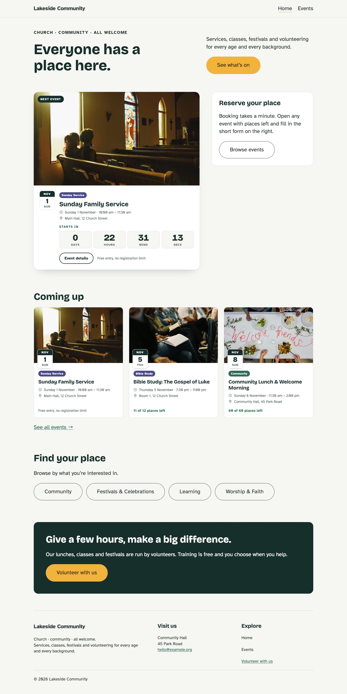
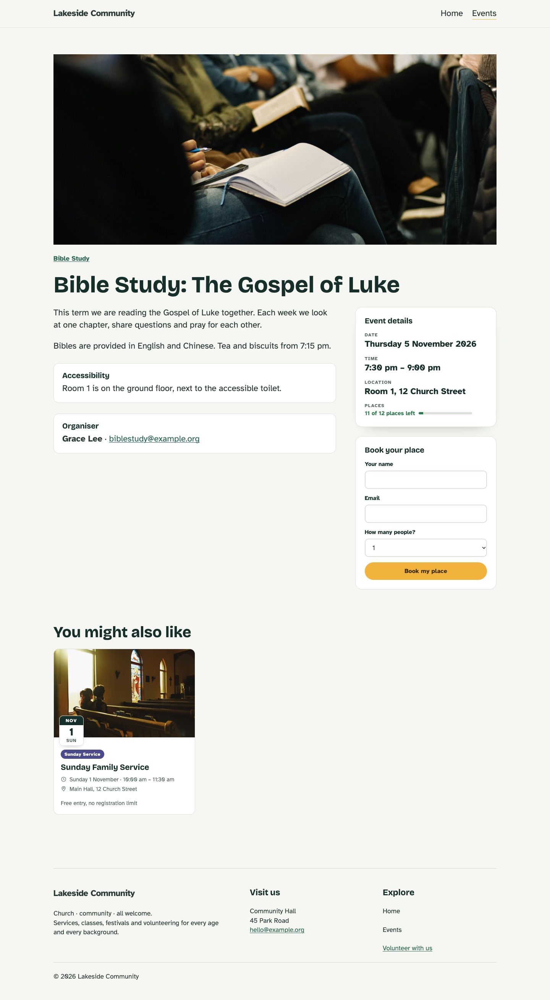
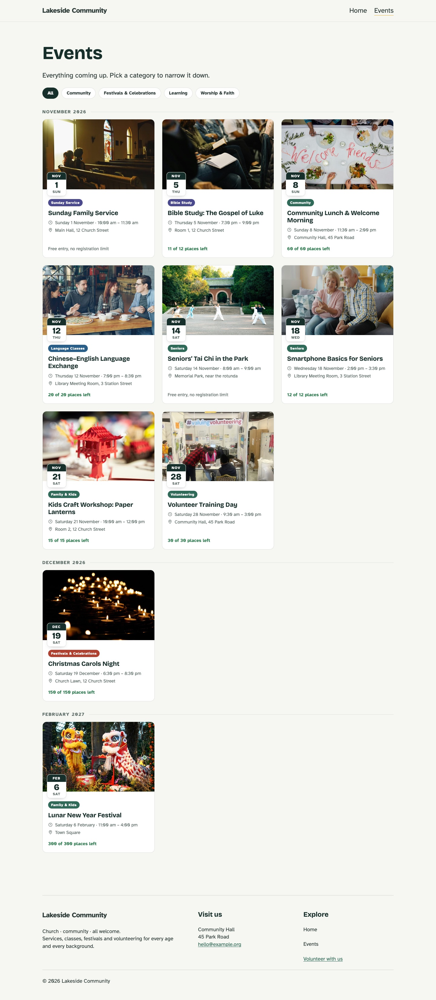
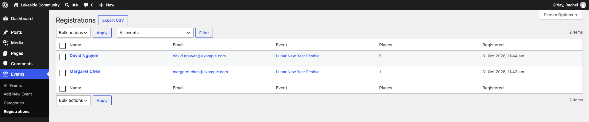

# Community Events Hub

A WordPress plugin that helps churches, community groups and nonprofits publish events and take registrations. Volunteers manage everything from the WordPress admin, with no coding needed.

Built with Gutenberg blocks (React), PHP and the WordPress REST API.

## Live demo

[**Open the demo in WordPress Playground →**](https://playground.wordpress.net/?blueprint-url=https://raw.githubusercontent.com/yulanh7/wp-community-events-block/main/playground/blueprint.json)

The demo runs entirely in your browser, so the first load takes a little while. You are logged in as an administrator: try booking a place on an event, then see it under **Events → Registrations** in the admin. Nothing is saved after you close the tab, and emails are not sent.

## Screenshots

| Home page | Event page with the registration form |
| --- | --- |
|  |  |

| Events archive | Registrations in the admin |
| --- | --- |
|  |  |

## Features

### Phase 1: Event display

- [x] Event custom post type with date, time, location and capacity
- [x] Event categories
- [x] Optional ACF integration: organizer, contact, accessibility notes and related events
- [x] Upcoming Event block: the next event, with a live countdown
- [x] Event List block: card grid with category filters, month grouping, past events and related events
- [x] Event Details block: date, time, location and places, or accessibility and organiser details
- [x] Block templates for single events, the events archive and event categories
- [x] Home page block pattern

### Phase 2: Registration

- [x] Event settings panel in the editor sidebar (React): start, end, location and places
- [x] Event Registration block: name, email and number of people, sent with `fetch` and no page reload
- [x] Custom REST API endpoint with nonce check, schema validation, a honeypot and capacity checks
- [x] Registrations stored in a custom database table, with places left updated everywhere
- [x] Admin registration list with an event filter, editing, deleting (one or in bulk) and CSV export
- [x] Confirmation email to the attendee and a notice to the organiser

### Phase 3: Real-world use

- [ ] Translation-ready (WordPress i18n)
- [ ] Add to calendar (`.ics` download, no third-party services)
- [ ] Monthly calendar view block
- [ ] Privacy tools for exporting and deleting registration data (Australian Privacy Act basics)

### Phase 4: Quality and release

- [ ] Accessibility review (keyboard navigation, contrast, form labels)
- [ ] GitHub Actions for linting and building a release zip
- [ ] Live demo on WordPress Playground

## Blocks, templates and patterns

All four blocks are dynamic: `render.php` builds the HTML on every page load, so dates and places are always current. The editor shows a live preview through `ServerSideRender`.

| Block | What it shows | Main settings |
| --- | --- | --- |
| Upcoming Event | The next event as a featured card | Show countdown |
| Event List | Upcoming events as cards | Number, columns, category, filters, group by month, past events, related to current event |
| Event Details | Facts about the current event | Summary (date, time, location, places) or info (accessibility, organiser) |
| Event Registration | A booking form for the current event, hidden for free and finished events | None: everything comes from the event |

When editing an event, an **Event settings** panel in the editor sidebar sets the start and end time, location and number of places. It is a small React app (`registerPlugin` and `PluginDocumentSettingPanel`) that saves to post meta through the REST API.

The plugin also registers block templates, so an event site works as soon as the plugin is active:

| Template | Used for |
| --- | --- |
| `single-ce_event` | A single event: image, details, registration form and related events |
| `archive-ce_event` | `/events/`: all upcoming events with category filters, grouped by month |
| `taxonomy-ce_event_category` | `/event-category/<slug>/`: events in one category |

On single event and event category pages, a menu link to `/events/` gets the `current-menu-ancestor` class, so the theme can highlight Events as the current section. WordPress only marks that link on `/events/` itself.

A **Community home page** pattern (in the inserter under **Patterns → Community Events**) adds an intro, the next event, upcoming events, category links and a volunteer call to action.

## Requirements

- WordPress 7.0 or later
- PHP 7.4 or later
- Node.js 20.19+ or 22.13+ (for building the blocks)
- A local WordPress environment, such as [Local](https://localwp.com/)
- [Advanced Custom Fields](https://wordpress.org/plugins/advanced-custom-fields/) (free, optional) for extra event fields

## Data model

Core event data uses native WordPress APIs, so the plugin works without any other plugins:

| Data | Storage | Registered with |
| --- | --- | --- |
| Events | `ce_event` post type | `register_post_type()` |
| Categories | `ce_event_category` taxonomy | `register_taxonomy()` |
| Start, end, location, capacity | Post meta, exposed in the REST API | `register_post_meta()` |
| Organizer, email, accessibility notes, related events | ACF fields, only when ACF is active | `acf_add_local_field_group()` |
| Registrations | Custom table `{prefix}ce_registrations` | `dbDelta()` on activation and on version change |

Core fields use native meta because registrations read capacity through the REST API with strict types. Display-only fields use ACF for a faster, friendlier admin UI. The ACF field group is defined in PHP, so it is version-controlled and ships with the plugin.

Registrations live in their own table rather than in post meta or a post type. Counting places is a single indexed `SUM()` query, and a unique key on `(event_id, email)` stops the same person booking twice, even if two requests arrive together. The table is removed when the plugin is deleted (not when it is deactivated), so no personal data is left behind.

## REST API

The registration form posts JSON to:

```
POST /wp-json/community-events/v1/events/{id}/registrations
```

| Parameter | Type | Rules |
| --- | --- | --- |
| `name` | string | Required, 1 to 100 characters, HTML removed |
| `email` | string | Required, valid email, up to 100 characters |
| `places` | integer | 1 to 5, default 1 |
| `website` | string | Honeypot: must be empty |

The request needs an `X-WP-Nonce` header created with `wp_create_nonce( 'wp_rest' )`. The block adds it to the form, so it works for visitors who are not logged in.

| Status | Code | When |
| --- | --- | --- |
| 201 | | Registered. Returns `message`, `placesLeft` and `placesHtml` |
| 400 | `rest_invalid_param`, `community_events_invalid_name` | A parameter is missing or breaks the rules |
| 403 | `community_events_expired` | The nonce is missing or expired |
| 404 | `community_events_not_found` | No published event with this ID |
| 409 | `community_events_started` | The event has already started |
| 409 | `community_events_no_registration` | Free entry event: no booking needed |
| 409 | `community_events_already_registered` | This email is already registered for the event |
| 409 | `community_events_full`, `community_events_not_enough_places` | Not enough places left |

## Hooks

Other plugins and themes can extend the plugin without changing its code:

| Hook | Type | Use it to |
| --- | --- | --- |
| `community_events_registration_count` | filter | Change the number of places taken for an event (`$count`, `$post_id`) |
| `community_events_registered` | action | Run code after someone registers, such as syncing to a mailing list (`$registration_id`, `$event_id`) |
| `community_events_confirmation_email` | filter | Change the attendee's email (`$email`, `$registration`) |
| `community_events_organiser_email` | filter | Change the organiser's email (`$email`, `$registration`) |

The emails themselves are hooked on `community_events_registered`, so they can be turned off with `remove_action( 'community_events_registered', 'community_events_send_registration_emails' )`.

## Security and privacy

Registrations come from the public and hold personal details, so every step is checked:

- **Nonce:** every request must carry a valid `wp_rest` nonce, including from visitors who are not logged in.
- **Validation on the server:** the REST schema checks types, lengths, email format and the 1 to 5 range. The callback then checks that the event exists, has not started, takes bookings, has room, and that the email has not registered already. The browser's own checks are only for convenience.
- **Sanitising and escaping:** input is sanitised when saved, and every value is escaped when shown. Every SQL query uses `$wpdb->prepare()`.
- **Spam:** a hidden honeypot field catches bots without a CAPTCHA, which many older visitors find hard to use. Bots get a normal success reply, so they learn nothing.
- **Permissions:** only users who can `edit_others_posts` (Editors and Administrators) can see, edit, delete or export registrations. Every change and the export link also need a nonce, and edits are checked against the same rules as the public form.
- **CSV injection:** cells that start with `=`, `+`, `-` or `@` get a leading `'`, so Excel shows them as text instead of running them as formulas.
- **Clean uninstall:** deleting the plugin drops the registrations table and its option.

## Local development

1. Clone the repository into your site's plugins folder:

   ```bash
   cd wp-content/plugins
   git clone https://github.com/yulanh7/wp-community-events-block.git
   cd wp-community-events-block
   ```

2. Install dependencies:

   ```bash
   npm install
   ```

3. Build the blocks. The `build/` folder is not committed, so this step is required:

   ```bash
   npm run build
   ```

   While developing, use `npm run start` instead. It rebuilds automatically when files in `src/` change.

4. Activate **Community Events Hub** on the **Plugins** screen in WordPress.

### Demo content

To fill a local site with sample events and categories, run this from the WordPress root (in Local, use **Open site shell**):

```bash
wp eval-file wp-content/plugins/wp-community-events-block/bin/seed-demo-content.php
```

It creates 11 categories and 12 events (10 upcoming, 2 past), including ACF fields when ACF is active. Running it again updates the demo content instead of duplicating it. Event dates move forward by whole weeks when the script runs later, so the upcoming events are always in the future.

Featured images are attached from `demo-images/<event-slug>.jpg` (1600px, free-licence stock photos). They are only used for demo content and are not needed by the plugin itself.

### Available scripts

| Command | Description |
| --- | --- |
| `npm run start` | Build in watch mode for development |
| `npm run build` | Build for production |
| `npm run lint:js` | Check JavaScript code style |
| `npm run lint:css` | Check CSS code style |
| `npm run format` | Format code |
| `npm run plugin-zip` | Create an installable plugin zip |

## Project structure

```
wp-community-events-block/
├── wp-community-events-block.php   # Main plugin file: plugin header and block registration
├── includes/                       # PHP modules loaded by the main plugin file
│   ├── post-types.php              # Event post type and category taxonomy
│   ├── post-meta.php               # Event meta fields (date, location, capacity)
│   ├── acf-fields.php              # Optional ACF field group (runs only when ACF is active)
│   ├── template-tags.php           # Shared helpers: event queries, cards, dates, places
│   ├── registrations.php           # Registrations table: install, queries, places count
│   ├── rest-api.php                # REST endpoint the registration form posts to
│   ├── admin.php                   # Events → Registrations screen: edit, delete, CSV export
│   ├── class-registrations-table.php # WP_List_Table for the Registrations screen
│   ├── emails.php                  # Confirmation and organiser emails
│   ├── assets.php                  # Registers the shared stylesheet
│   ├── editor.php                  # Loads the Event settings sidebar in the editor
│   ├── templates.php               # Registers the block templates
│   ├── navigation.php              # Marks Events as the current menu section on event pages
│   └── patterns.php                # Registers the home page pattern
├── src/                            # Block source code (edit these files)
│   ├── upcoming-event/             # Each block: block.json, index.js, edit.js (React), render.php
│   ├── event-list/
│   ├── event-details/
│   ├── registration-form/          # Also view.js: sends the form with fetch
│   └── event-settings/             # Editor sidebar panel (not a block)
├── assets/css/community-events.css # Shared front-end styles for all blocks
├── templates/                      # Block templates (single event, archive, category)
├── patterns/home.php               # Home page pattern
├── bin/seed-demo-content.php       # WP-CLI script that creates demo events
├── demo-images/                    # Featured images for the demo events
├── playground/                     # Live demo: blueprint, site setup script, fonts, header and footer
├── .github/workflows/playground.yml # Builds the plugin to the `playground` branch for the demo
├── build/                          # Compiled output (generated, not committed)
├── webpack.config.js               # Adds the event-settings entry to the default build
├── uninstall.php                   # Removes the registrations table when the plugin is deleted
├── package.json                    # npm scripts and dependencies
└── readme.txt                      # WordPress.org plugin readme
```

## License

[GPL-2.0-or-later](https://www.gnu.org/licenses/gpl-2.0.html)
